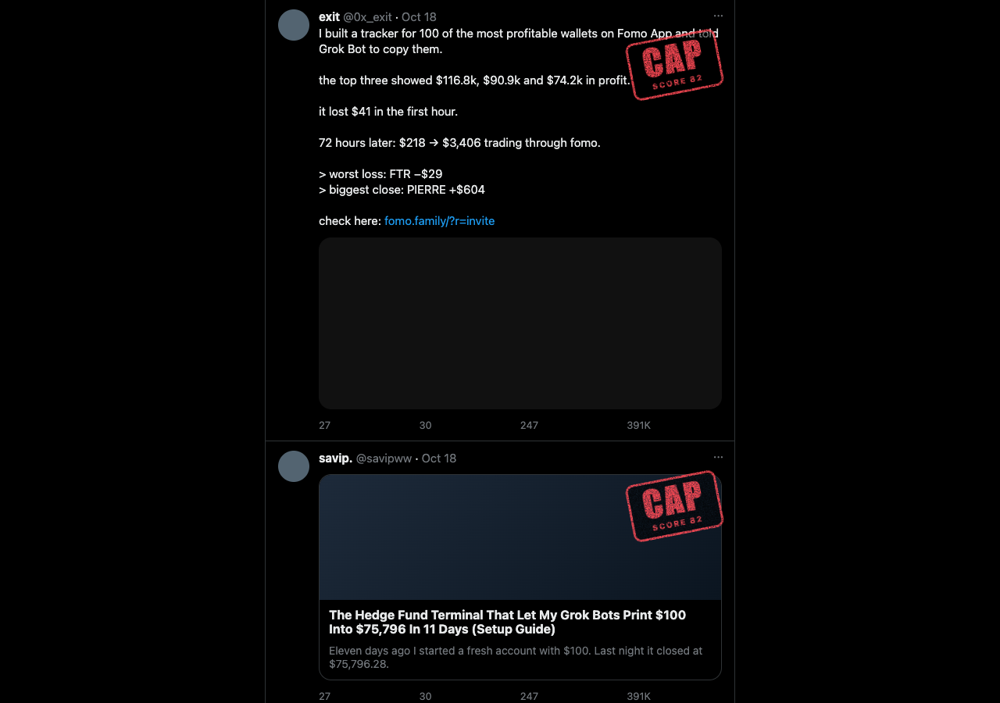

# CapChecker

A Chrome extension that stamps hype and scam posts on X with a **CAP** score, a **BAIT** score, and the reasons behind them.

Fake trading wins, "my AI built an app while I slept" threads, "drop the PDF below" follower farming and undisclosed referral links all follow the same patterns. CapChecker spots them while you scroll and stamps the post. Click the stamp to see why.



## Install (about 2 minutes)

CapChecker isn't on the Chrome Web Store yet, so you install it from the download:

1. **Download** `capchecker-x.y.z.zip` from the [latest release](https://github.com/500bitcoins/capchecker/releases/latest).
2. **Unzip it** (double-click on a Mac, right-click → Extract All on Windows). Move the folder somewhere it can stay, like Documents. Chrome runs the extension from this folder, so don't delete it.
3. **Open the extensions page:** type `chrome://extensions` in the address bar and press Enter.
4. **Turn on Developer mode** with the switch in the top-right corner.
5. **Click Load unpacked** and choose the unzipped folder (the one with `manifest.json` inside).
6. **Pin it:** click the puzzle-piece icon in Chrome's toolbar, then the pin next to CapChecker.
7. The CapChecker settings page opens. Paste your Darkwoods API key (see below) and press **Save and test**.
8. Open [x.com](https://x.com) and scroll.

Works in Chrome, Brave, Edge, Arc and other Chromium browsers (the extensions page is `brave://extensions`, `edge://extensions` and so on). It doesn't run in Safari, Firefox or the X phone apps.

## Get a Darkwoods API key

The free pattern check works without a key. AI checks run on your own [Darkwoods](https://app.darkwoods.ai/r/HPMFL2363ULQ) account and are paid from your credits (100 credits = $1).

1. Sign up at [Darkwoods](https://app.darkwoods.ai/r/HPMFL2363ULQ) and add some credits. A few dollars lasts a long time: a quick check costs about 0.05 credits.
2. In the Darkwoods app, open **Settings → API keys**, press **New key**, and copy it. It starts with `dwk_` and is only shown once.
3. Paste it into CapChecker's settings and press **Save and test**.

> The Darkwoods link above is a **referral link**: 500altcoins earns from what you spend on Darkwoods if you sign up through it.

**Darkwoods keys have no spending limit of their own.** A key can spend your whole balance. CapChecker stops at its own daily cap (50 credits by default, set in settings), but keep a small balance on the account you use, and revoke the key in Darkwoods if you stop using CapChecker.

## Using it

- **Stamps appear by themselves.** Posts that look suspicious get a quick AI check as they scroll into view, then a stamp.
- **Click a stamp** to see the scores and the reasons.
- **Deep check** (in the panel) researches the post with web search for about 5–15 credits. Use it when you want receipts.
- **Not cap / Not bait** hides a stamp you disagree with.
- **Any other post:** hover it and click the small **Cap?** button to check it yourself.
- **The toolbar icon** shows today's spending and lets you switch CapChecker off.

| Stamp | When |
|---|---|
| **CAP** (red) | Cap score 75–100. Always wins. |
| **CAP?** (orange) | Cap score 45–74, unless bait is higher |
| **BAIT** (yellow) | Bait score 60+ and higher than the cap score |
| Unclear | Cap score 20–44 |
| No cap | Cap score 0–19 |

**Cap** is how likely the post's claims are misleading. **Bait** is how much the post is built to farm follows, bookmarks and replies. A post can be true and still be bait. A red CAP stamp only ever comes from an AI check; the free pattern check on its own can only mark a post "Possible cap" or "Possible bait".

## Updating

Your version is shown at the bottom of the toolbar popup and the settings page. The newest version is always on the [releases page](https://github.com/500bitcoins/capchecker/releases/latest).

To update:
1. Download the new zip.
2. **Replace the files inside your existing CapChecker folder**, keeping the same folder.
3. Click the reload arrow on the CapChecker card in `chrome://extensions`, then refresh X.

Keeping the same folder keeps your key and settings. If you load a different folder, Chrome treats it as a new extension and you'll need to set it up again.

## How it works

1. **Pattern check (free, on your device).** Every post on screen is scored for the usual tells: "$218 → $3,406 in 72 hours", referral links, "who the f*ck built this" openers, "0 manual work", "drop the PDF below", guaranteed returns, coin-pump language, and text aimed at AI checkers.
2. **Quick check (AI, about 0.05 credits).** Flagged posts get a score and reasons from a fast model (Claude Haiku 5.5 by default).
3. **Deep check (AI, about 5–15 credits, on request).** A stronger model (Claude Opus 5.5 by default) researches the post with web search and reads the author's follow-up posts: does the tool exist and can it do what's claimed, is the link a referral programme, do the numbers agree.

Results are saved on your device for 7 days, so the same post is never paid for twice.

## Privacy

There's no CapChecker server. Your key stays on your device, and post text only leaves it when an AI check runs. See [PRIVACY.md](PRIVACY.md).

## Limits

- It's an automated opinion and it can be wrong.
- X changes its page layout from time to time, which can break the stamps until CapChecker is updated.

## Development

```bash
npm install
npm test
```

`npm test` runs the rule and verdict tests. `npm run test:e2e` loads the extension into Chromium against a mock X timeline. Set `DARKWOODS_API_KEY` to include real quick checks (about 0.2 credits), and `E2E_DEEP=1` to add one deep check.

To run the real checks on any post from the command line (handy when tuning the prompts):

```bash
DARKWOODS_API_KEY=dwk_... npm run check -- https://x.com/user/status/123 --deep
```

`npm run zip` builds `dist/capchecker-<version>.zip` for a release or the Chrome Web Store.

## License

MIT. Made by [@500altcoins](https://x.com/500altcoins).
